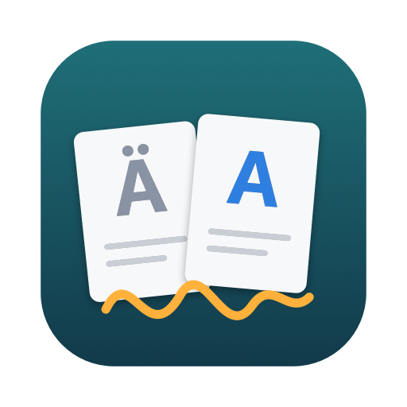
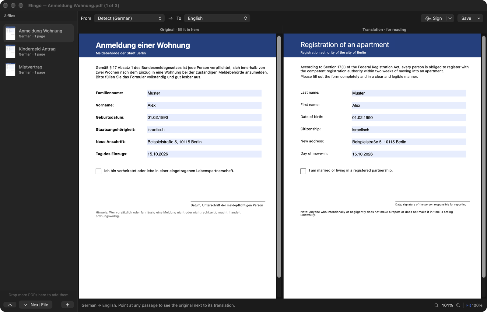
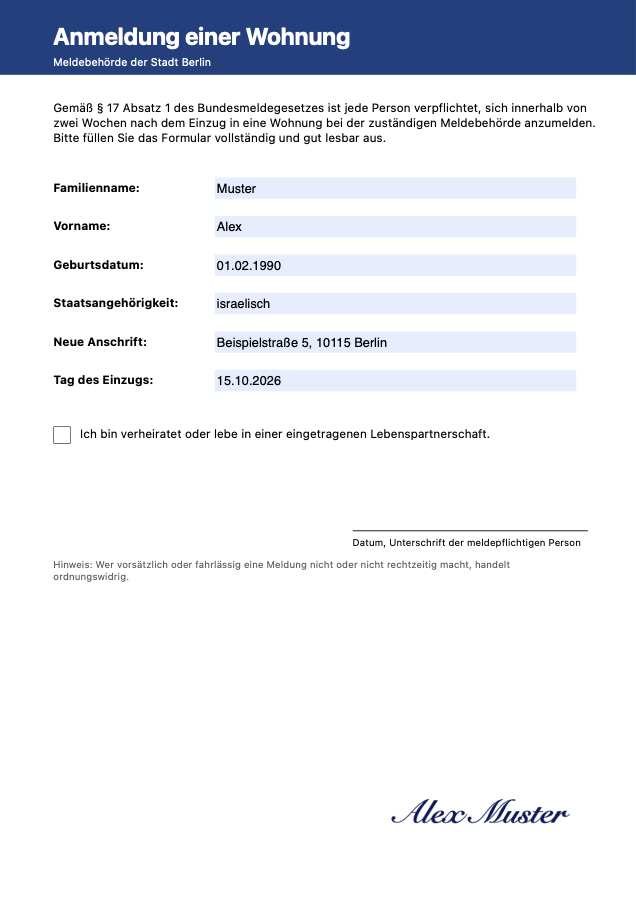

<p align="center"></p>

<h1 align="center">Elingo</h1>

<p align="center"><b>Fill in and sign PDFs in a language you don't read.</b><br>
The form on the left, the same pages translated into your language on the right.</p>

<p align="center">
  <a href="https://github.com/eladitz/elingo/releases/latest/download/Elingo.dmg"><b>Download for Mac</b></a> ·
  <a href="https://ai.itzkin.com/elingo.html">Website</a> ·
  <a href="https://ko-fi.com/eladitzkin">Support on Ko-fi ☕</a>
</p>

<p align="center"></p>

Free and open source. Apple Silicon and Intel, macOS 26 or later.

## What it does

- **Two pages side by side.** Fill in the original on the left. On the right, every passage is translated in its own place, on the page's own colours, so you can see which German label means "Date of birth".
- **What you type shows on both sides,** and the two scroll and zoom together.
- **Point at any passage** on either side to see the original next to its translation.
- **Any language.** The document's language is detected; pick yours from around 50. Translation is Apple's, on your Mac: nothing is uploaded. A language you haven't used before is downloaded once (macOS asks).
- **Scans work too:** pages without text are read with on-device text recognition.
- **Several files at once.** Open a stack of PDFs and they share one window with a file list. All of them translate straight away; ⌘] and ⌘[ move between them. Drop more onto the list to add them.
- **Sign:** draw your signature or type your name, click where it goes, drag to move it, drag its corner to resize.
- **Save Signed & Locked** (⌘S): your answers and signature become part of the pages and the file is protected against changes (it can still be opened, printed and copied from). Or save the form still editable, or save the translation as a PDF for your records.
- **Zoom:** the bar at the bottom, ⌘+ / ⌘− / ⌘0, the mouse wheel (hold ⌥ to scroll instead), or pinch.

<p align="center"></p>

A signature here is a picture of your signature with an edit lock, like signing a printout. It isn't a certificate-based digital signature, which some online portals ask for.

Elingo is also the **Translate** tool in [Elconvo](https://github.com/eladitz/elconvo): ⌥⇧-drag PDFs and pick Translate.

## Install

Download [Elingo.dmg](https://github.com/eladitz/elingo/releases/latest/download/Elingo.dmg), open it and drag Elingo into Applications. The first time, macOS may say it can't check the app: open **System Settings ▸ Privacy & Security** and click **Open Anyway**. Elingo checks for new versions once a day.

## Build it yourself

Needs the Command Line Tools (`xcode-select --install`), not Xcode.

```bash
./build.sh      # build/Elingo.app
./package.sh    # build/Elingo.dmg
```

| File | What's in it |
|---|---|
| `Sources/App.swift` | App, menus, start window |
| `Sources/Workspace.swift` | The window with the file list |
| `Sources/Window.swift` | One file: the two views, sync, hover, zoom, saving |
| `Sources/Layout.swift` | Finding the passages on a page (text or OCR) |
| `Sources/Translator.swift` | Apple's Translation framework |
| `Sources/Mirror.swift` | The translated pages |
| `Sources/Signature.swift` | Signature pad, placing, signed & locked saving |
| `Sources/Donate.swift`, `Updater.swift` | Monthly Ko-fi note, daily update check |

## Support

Elingo is free and made by one person. If it saves you an afternoon with a form, a coffee on **[Ko-fi](https://ko-fi.com/eladitzkin)** keeps it going.

MIT licensed.
